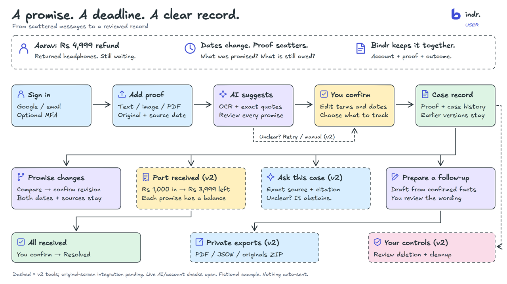
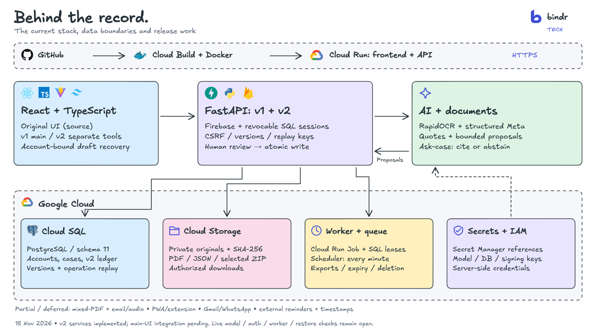

# Bindr

**A promise. A deadline. A clear record.**

Companies promise refunds, replacements and service fixes across messages and documents. When dates change, the proof gets scattered. Bindr keeps the original evidence, confirmed terms, revisions and outcome in one place.

> Hackathon release: the combined workflow has been tested locally. Google Cloud is the deployment target; live deployment and a real Meta provider call still need verification. See [migration status](docs/GOOGLE_CLOUD_MIGRATION.md) and [release audit](docs/RELEASE_AUDIT.md).

## Try the story

1. Open the workspace and paste a synthetic company message, or upload a text file, text-layer PDF, PNG or JPEG.
2. Let the backend extract a suggested promise and its exact supporting quotation. Screenshots use OCR.
3. Review the amount, currency and deadline, then explicitly confirm. Suggestions alone never become tracked commitments.
4. Add a revised communication to the same case. Confirm its predecessor; the original promise and evidence stay preserved.
5. Prepare an editable factual complaint, review it and copy/download the text. When everything is received, confirm full resolution.

Example message: **“We will refund INR 4999 for the returned headphones within three business days.”** Confirm the actual deadline during review; Bindr does not assume the upload date is the message date.



*Design overview. Starred partial-payment and manual-entry paths are demo-only extensions; they are not supported in the connected release.*

## What works

- Responsive React workspace: cases, search, confirmed deadlines, evidence library, activity and case history.
- FastAPI-backed creation, private evidence upload/download, extraction, human review, revisions, complaint preview and full resolution.
- Original file hashes, linked quotations, preserved predecessors, ownership checks and stale-write protection.
- PostgreSQL records in Cloud SQL and original files in private Cloud Storage. Frontend and API share one Cloud Run HTTPS origin.



*Architecture overview. PNG/JPEG OCR is supported. Hosting now targets Cloud Run, Cloud SQL and private Cloud Storage; older hosting labels in the diagram describe the original design. An S3 implementation is not included.*

## How it is built

**React 19 · TypeScript · Vite · FastAPI · SQLAlchemy · PostgreSQL · RapidOCR · Meta Model API · Google Cloud**

The browser calls `/api/v1` with signed session cookies and CSRF protection. FastAPI validates files and AI output, checks ownership and atomically applies reviewed changes. Provider secrets stay on the server. Complaints are generated from confirmed facts; nothing is automatically sent or filed.

The Meta adapter extracts one primary promise per source file. A missing or ambiguous date remains unset until the user confirms it. OCR and AI can make mistakes; source-linked human review is required.

## Run locally

Requires Python 3.12+ and Node.js 22.

```bash
python3 -m venv .venv
source .venv/bin/activate
pip install -r backend/requirements-runtime.txt
cd frontend
npm ci
VITE_USE_MOCK=false VITE_API_URL=/api/v1 npm run build
cd ..
AI_PROVIDER=mock uvicorn backend.app.main:app --host 127.0.0.1 --port 8000
```

Open **http://127.0.0.1:8000**. Local mode uses SQLite and a clearly labelled offline extractor, not live AI. For real AI, set `AI_PROVIDER=meta` and `MODEL_API_KEY` in the server environment; confirm the intended `META_MODEL` and `META_BASE_URL`. Never place credentials in `VITE_` variables or Git.

## Deploy

Follow the [Google Cloud deployment guide](docs/DEPLOYMENT.md): Cloud Run serves the app, Cloud SQL stores records, Cloud Storage keeps private originals and Secret Manager holds credentials. The [deploy script](scripts/deploy-google-cloud.sh) builds and publishes Docker after one-time project setup. The existing AI provider is unchanged. A public URL will be added after live acceptance passes.

## Scope and limits

This is an anonymous browser workspace: the cookie holds access for up to 30 days in the deployment configuration. Clearing/losing it loses access; account recovery and cross-device login are not implemented. Use synthetic evidence for judging.

Full resolution and reviewed revisions persist. Partial receipts, manual-only saving, reopen/archive/delete, persistent complaint drafts, notification delivery and scanned-PDF OCR are outside the connected MVP. Settings affect local presentation; there are no background reminders. Uploads are limited to 10 MiB each, 30 files per case and 50 MiB per workspace; extraction has a basic abuse limit.

## Team and verification

- **Akshit Bhargav:** product, integration and release coordination.
- **Tushar Aggarwal (`biney25`):** frontend.
- **Lokesh Goel (`lokesh-27-goel`):** backend.
- **Kunal Gupta:** AI extraction and document processing.

The release merges the original feature branches without squashing their history, preserving author attribution. See [release audit](docs/RELEASE_AUDIT.md) for test evidence and remaining deployment checks. Earlier phase handovers describe historical snapshots.
